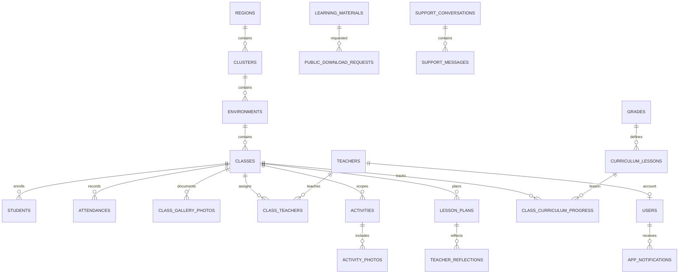

# Dokumentasi Teknis — Sistem Pengelolaan Kelas Anak

Dokumen ini menjelaskan kondisi implementasi dan pemeriksaan yang dilakukan pada 25 Oktober 2026. Versi paket berasal dari dependency yang terpasang; struktur database berasal dari koneksi MySQL aktif bernama `db_anakanak`. Jangan menaruh password, token, atau isi `.env` dalam dokumentasi atau issue publik.

## A. Gambaran Umum

Sistem ini adalah aplikasi web Laravel untuk mengelola kelas anak, peserta, guru, kurikulum, kegiatan, dan komunikasi. Antarmuka publik menyediakan informasi kelas dan wilayah. Dashboard terautentikasi membatasi fitur berdasarkan role Admin atau Guru.

### Role dan hak akses

| Role | Hak akses utama |
| --- | --- |
| Pengunjung | Melihat beranda, Classes, Regions, materi publik; mengirim percakapan dukungan dan permintaan izin materi. |
| Admin | Mengelola data dan akun, meninjau aktivitas serta materi, melihat chat, mengelola kontak publik, ekspor data, dan mengelola backup. Route Admin memakai autentikasi, middleware role, serta pemeriksaan kewajiban ganti password. |
| Guru | Mengelola data operasional kelas yang ditugaskan kepadanya, membuat lesson plan/refleksi/aktivitas, mengelola galeri kelas yang dapat diaksesnya, memakai materi Guru yang diizinkan, dan melihat notifikasi/chat. Akses kelas dibatasi melalui relasi penugasan. |

Tidak ada alur pendaftaran akun publik. Akun Admin awal dibuat secara interaktif lewat Artisan; akun baru diwajibkan mengganti password. Username, email, password, avatar, dan profil selanjutnya dikelola melalui Profile sesuai validasi aplikasi.

### Alur penggunaan ringkas

1. Pengunjung menjelajahi informasi publik dan mengirim pesan atau permintaan akses materi.
2. Admin masuk, mengelola lokasi/kelas/pengguna, lalu memeriksa aktivitas, permintaan materi, percakapan, notifikasi, dan backup.
3. Guru masuk menggunakan akun yang ditugaskan Admin, memilih kelas yang memang dapat diakses, lalu mengelola pembelajaran dan dokumentasi.
4. Untuk materi Modul Buku 3, pengguna publik meminta izin membaca atau mengunduh. Admin menyetujui/menolak; link status rahasia menjadi jalur akses setelah persetujuan.

## B. Fitur

### Publik

| Fitur / lokasi | Tujuan dan alur | Data dan pembatasan |
| --- | --- | --- |
| Beranda (`/`) | Ringkasan program, statistik publik, komunitas, aktivitas, kontak dan tautan navigasi. Elemen bagian halaman memakai scroll-reveal yang dapat muncul kembali saat digulir, awan pembatas bergerak perlahan, serta animasi masuk/hover ringan. | Menampilkan statistik dan konten publik, bukan data alamat/identitas peserta. JavaScript scroll-reveal dimuat pada halaman; bila JavaScript tidak aktif atau `prefers-reduced-motion` dipilih, konten tetap terlihat dan animasi gerak dinonaktifkan. |
| Classes (`/classes`) | Penjelasan interaktif tujuh aktivitas kelas, cerita contoh, statistik, daftar kelas aktif, dan form izin Modul Buku 3. | Daftar kelas hanya menampilkan kelas aktif; jumlah peserta bersifat ringkasan. Form memilih `read` atau `download`; akses file langsung pada route modul lama diblokir di server. |
| Regions (`/regions`) | Menjelajahi Region, Klaster, Lingkungan dan kelas yang tersedia. | Hanya data aktif yang dipublikasikan; detail privat peserta tidak ditampilkan. |
| Materi publik (`/materi`) | Meminta izin akses materi yang tersedia. | Nama, email, materi, dan jenis akses divalidasi; endpoint permintaan dibatasi `throttle:5,1`. Nilai bawaan permintaan lama adalah `download`. |
| Chat dukungan | Pengunjung memulai chat dan memakai tautan token untuk membuka percakapan kembali; Admin/Guru membalas dari dashboard. | Token pengunjung disimpan sebagai hash. Endpoint kirim pesan diberi pembatasan `throttle:10,1`. |

### Dashboard Admin

- **Dashboard dan master data:** ringkasan jumlah dan pengelolaan Region, Klaster, Lingkungan, Kelas, serta Participants.
- **Teacher Accounts:** membuat, memperbarui, menonaktifkan, mengaktifkan kembali, atau menghapus akun Guru sesuai prasyarat assignment. Form assignment menyajikan filter Region → Klaster → Lingkungan; menyaring tampilan tidak menghapus checkbox assignment yang tersembunyi.
- **Activity Review:** memeriksa dan menerbitkan/mengarsipkan kiriman Guru. `Delete All` menghapus seluruh aktivitas dalam cakupan yang ditampilkan di Activity Review (scope `class`, `environment`, `cluster`), metadata fotonya, serta file yang berada di direktori `activity-photos/`. Log audit bulk tetap disimpan. Kegagalan hapus file dicatat dan diberitahukan.
- **Permintaan materi:** melihat jenis akses yang diminta, menyetujui/menolak permintaan, dan menghapus permintaan. Hanya Admin yang dapat memutuskan permintaan.
- **Backup dan ekspor:** SQL backup adalah file privat; ekspor Excel dapat difilter sesuai data dan hierarki. Tombol `Delete All` hanya menargetkan file `.sql` di folder `backups/`; tidak ada tabel metadata backup terpisah dan log audit tidak ikut dihapus.
- **Chat, notifikasi, kontak publik, panduan pengguna, dan progress kelas:** tersedia melalui route dan halaman Admin terkait.

### Dashboard Guru

- Dashboard menampilkan kelas yang ditugaskan, peserta, kegiatan, dan alat pembelajaran.
- Operasi peserta, kehadiran, perkembangan, aktivitas, parent visit, lesson plan, refleksi, dan galeri dibatasi oleh kelas Guru.
- Galeri menerima gambar JPG/JPEG/PNG/WebP sampai 10 MB, disimpan pada disk privat `local`, serta menyimpan tanggal, sesi, caption, kelas, dan uploader. Hapus foto memeriksa assignment kelas; metadata dihapus walaupun file lama sudah tidak tersedia. Kegagalan menghapus file dicatat dan ditampilkan.
- Avatar memakai `users.avatar_path` atau pilihan `users.avatar_type` sebagai sumber yang sama pada Profile, Dashboard Guru, dan daftar akun Guru Admin.
- Storyboard cerita dibuat secara lokal sebagai SVG berdasarkan pemisahan adegan dan pencocokan kata kunci. Ini bukan layanan image-generation AI eksternal; teks cerita tidak dikirim ke provider pihak ketiga.
- Lesson plan mendukung tipe `class` dan `other`. Pengingat email dikirim oleh command terjadwal untuk jadwal satu atau dua hari ke depan, sesuai `reminder_days`.

### Izin membaca/mengunduh Modul Buku 3

1. Pengunjung memilih jenis izin pada form di halaman Classes.
2. `LearningMaterialController` membuat permintaan `pending`, menghasilkan token akses acak, dan menyimpan hash SHA-256 token. Admin menerima notifikasi aplikasi.
3. Admin memutuskan permintaan. Halaman status menunjukkan hasil dan menyediakan hanya aksi yang disetujui.
4. Endpoint baca mensyaratkan status `approved` dan `requested_action=read`; endpoint unduh mensyaratkan `approved` dan `requested_action=download`. Token tidak dapat menukar jenis izin.
5. URL langsung `/classes/module` dan `/classes/module/download` selalu menolak akses. Guru juga tidak dapat melewati alur lewat endpoint materi staff; Admin dapat mengakses dari ruang Admin.

### Penghapusan data dan penanganan error

- Operasi bulk tersedia hanya melalui middleware Admin dan memakai metode HTTP `DELETE` serta konfirmasi UI.
- Penghapusan backup membatasi file berdasarkan ekstensi `.sql` di `backups/`; file non-SQL dan tabel database tidak disentuh.
- Penghapusan Activity Review membatasi query ke tiga scope terkait dan tidak menyentuh log audit.
- Untuk partial failure storage, aplikasi mencatat konteks teknis di log dan menampilkan pesan peringatan kepada pengguna.

## C. Teknologi dan Tools

Versi berikut diverifikasi dari package manager yang terpasang saat dokumentasi dibuat:

| Teknologi | Versi / sumber | Fungsi |
| --- | --- | --- |
| PHP | 8.5.8 pada CLI | Runtime backend. |
| Laravel Framework | 13.37.0 (`composer show --direct`) | Routing, middleware, session, validasi, Eloquent, migrasi, storage, scheduler, dan Blade. |
| Pest | 5.3.3; Laravel plugin 5.0.1 | Feature dan unit test. |
| Laravel Pint | 1.32.1 | Format PHP. |
| Tailwind CSS | 4.3.3 (`npm list --depth=0`) | Utility styling, dikompilasi melalui Vite. |
| Vite | 8.3.4 | Build aset frontend. |
| Laravel Vite Plugin | 3.2.0 | Integrasi manifest aset Laravel. |
| MySQL | 8.0.30 pada koneksi aktif; database `db_anakanak` | Penyimpanan aplikasi. PHPUnit memakai SQLite in-memory sesuai `phpunit.xml`. |

Versi tersebut adalah keadaan instalasi saat pemeriksaan, bukan klaim tentang semua mesin deployment. `composer.json` menetapkan PHP `^8.3` dan Laravel `^13.17`; `package.json` menetapkan Tailwind `^4.0.0` dan Vite `^8.0.0`.

## D. Struktur Project

| Lokasi | Fungsi aktual |
| --- | --- |
| `app/Actions/` | Operasi domain yang digunakan ulang, termasuk backup database dan storyboard lokal. |
| `app/Console/Commands/` | Command Admin, backup/restore, dan pengingat lesson plan. |
| `app/Http/Controllers/` | Controller publik, Auth, Admin, dan Guru. |
| `app/Mail/` | Email lesson reminder. |
| `app/Models/` | Model Eloquent dan relasi database. |
| `app/Providers/` dan `app/View/` | Pendaftaran layanan dan komponen/view support. |
| `app/Support/` | Helper akses kelas Guru dan dukungan domain lain. |
| `bootstrap/` | Bootstrap aplikasi dan cache konfigurasi/runtime. |
| `config/` | Konfigurasi database, storage, queue, session, mail, dan aplikasi. |
| `database/migrations/` | Evolusi skema; perubahan baru izin baca/unduh memakai migration tersendiri. |
| `database/factories/`, `database/seeders/` | Data factory dan seeder pengembangan. Seeder tidak menggantikan pembuatan Admin utama. |
| `resources/views/` | Halaman Blade publik, Admin, Guru, Auth, layout, dan komponen UI. |
| `resources/css/`, `resources/js/` | CSS dan JavaScript frontend yang masuk pipeline Vite. |
| `public/images/`, `public/build/`, `public/storage/` | Aset lokal, build Vite, dan symbolic link storage opsional; gambar upload publik diakses lewat controller. |
| `routes/web.php`, `routes/console.php` | Endpoint HTTP dan jadwal Artisan. |
| `storage/app/` | File private, termasuk backup SQL, galeri Guru, dan storyboard. |
| `tests/Feature/`, `tests/Unit/` | Tes HTTP/integrasi dan tes unit. |
| `docs/` | Dokumentasi teknis, desain, dan instruksi pengembangan. |

## E. Database

### Koneksi dan aturan umum

- DBMS aktif yang diperiksa adalah MySQL; nama database `db_anakanak`.
- Primary key mayoritas tabel adalah `id` bertipe `BIGINT UNSIGNED`.
- Relasi penting diwujudkan dengan foreign key; beberapa tabel menerapkan unique key atau index gabungan. Penghapusan memiliki tindakan `cascade`, `restrict`, atau `set null` sesuai relasi.
- Nilai password disimpan sebagai hash Laravel. Token percakapan publik dan token status materi disimpan sebagai hash; nilai asli tidak ditaruh di tabel. Jangan mengekspor kredensial.
- Session memakai driver `database`; queue memakai `database`. Backup file fisik berada pada disk private, bukan row tabel.

### Tabel yang terdeteksi

54 tabel dasar ditemukan pada koneksi aktif ketika pemeriksaan dilakukan. Tabel `migrations`, `sessions`, cache, dan queue merupakan dukungan framework; fungsi bisnis diringkas pada kelompok berikut.

| Kelompok | Tabel | Fungsi |
| --- | --- | --- |
| Lokasi dan kelas | `regions`, `clusters`, `environments`, `classes` | Hierarki wilayah sampai kelas. `clusters.region_id`, `environments.cluster_id`, dan `classes.environment_id` menjaga relasi parent; kelas juga dapat merujuk `grades`. |
| Identitas dan assignment | `users`, `teachers`, `class_teachers`, `students` | Akun pengguna/role, profil Guru, pivot assignment Guru-Kelas dengan `is_primary`, dan data peserta. `users.teacher_id` unik untuk menghubungkan akun Guru; `students.class_id` menunjuk kelas. |
| Operasional kelas | `attendances`, `development_categories`, `developments`, `parent_visits`, `parent_questions`, `teacher_reflections`, `knowledge_sharing` | Kehadiran, catatan perkembangan berkategori, kunjungan/pertanyaan orang tua, refleksi Guru, dan pengetahuan pembelajaran. |
| Kurikulum | `grades`, `curriculum_lessons`, `class_curriculum_progress`, `lesson_plans`, `lesson_sections`, `lesson_prayers`, `lesson_quotes`, `lesson_songs`, `lesson_stories`, `lesson_games`, `lesson_media`, `student_quote_progress` | Program dan lesson, progres per kelas, rencana lesson, komponennya, referensi media/kegiatan, dan progres kutipan peserta. |
| Referensi kegiatan lesson | `prayers`, `quotes`, `songs`, `stories`, `games`, `coloring_pages` | Konten referensi untuk aktivitas kurikulum. `stories` juga menyimpan metadata/path ilustrasi lokal. |
| Aktivitas dan galeri | `activities`, `activity_photos`, `class_gallery_photos` | Pengajuan kegiatan dengan scope class/environment/cluster, foto yang direview, dan foto galeri privat per kelas. |
| Materi dan notifikasi | `learning_materials`, `public_download_requests`, `app_notifications` | Metadata materi, permintaan izin publik, serta notifikasi terkait request/refleksi/chat. |
| Chat dukungan | `support_conversations`, `support_messages` | Percakapan dengan sumber publik atau user login dan pesan berurutan. Token guest disimpan sebagai hash. |
| Konten publik | `public_activity_cards`, `public_contacts`, `banners`, `information` | Kartu aktivitas, pilihan kontak publik, banner, dan konten informasi publik. |
| Audit dan framework | `audit_logs`, `migrations`, `sessions`, `password_reset_tokens`, `cache`, `cache_locks`, `jobs`, `job_batches`, `failed_jobs` | Audit operasi, status migrasi, session/reset password, cache, dan queue. |

### Kolom/constraint penting

- `regions`: `id`, `name`, `code`, `is_development`, `is_active`; `code` unik.
- `clusters`: `region_id`, `name`, `code`, `is_active`; `region_id` mengarah ke `regions`, unik gabungan `(region_id, code)`.
- `classes`: `environment_id`, `grade_id`, `name`, `code`, `location`, `schedule`, `status`, `photo_path`; `code` unik bila terisi.
- `users`: `username`, `name`, `email`, `password`, `role`, `status`, `teacher_id`, `must_change_password`, `avatar_path`, `avatar_type`; email/username unik dan `teacher_id` unik nullable.
- `class_teachers`: unique `(class_id, teacher_id)` serta `is_primary`.
- `students`: `class_id`, `full_name`, `nickname`, `gender`, `birth_date`, `address`, `parent_name`, `parent_phone`, `status`, `student_code`; `student_code` unik nullable.
- `attendances`: `student_id`, `class_id`, `attendance_date`, `status`, `note`, `recorded_by`; unique `(student_id, attendance_date)`.
- `lesson_plans`: `class_id`, `curriculum_lesson_id`, `created_by`, `execution_date`, `plan_type`, `reminder_days`, `reminder_sent_at`, `program`, `materials`. Index reminder `(plan_type, execution_date, reminder_sent_at)`.
- `activities`: `scope_type`, `class_id`, `environment_id`, `cluster_id`, `status`, tanggal, creator dan reviewer. Trigger MySQL memvalidasi hanya satu owner scope yang sesuai.
- `activity_photos`: `activity_id`, `file_url`, `is_approved`, reviewer. FK `activity_id` memakai restrict sehingga penghapusan massal menghapus metadata foto dulu.
- `class_gallery_photos`: `class_id`, `uploaded_by`, `photo_date`, `session_label`, `caption`, `file_path`.
- `learning_materials`: `slug`, `type`, `title`, `file_path`/`external_url`, `is_system`, `is_active`.
- `public_download_requests`: `learning_material_id`, nama/email pemohon, `requested_action` (`read` atau `download`), `access_token_hash`, `status`, reviewer/tanggal/catatan.
- `support_conversations`: `user_id`, `source`, `guest_name`, `guest_token_hash`, `status`, `last_message_at`; `support_messages` merujuk percakapan dan pengirim.
- `audit_logs`: `user_id`, `action`, `entity_type`, `entity_id`, metadata JSON, IP, waktu.

### Relasi (ERD ringkas)



Diagram ini merangkum relasi kunci, bukan seluruh kolom atau constraint tabel.

### File storage

- Backup database: disk `local`, direktori relatif `backups/`, file `.sql`; tidak ada tabel metadata backup.
- Foto galeri dan storyboard: disk private `local`.
- Avatar, foto kelas, dan kartu aktivitas publik: menggunakan disk `public`, tetapi dikirim melalui route `/public-media/...`; route ini tidak membutuhkan symbolic link `public/storage`.
- Foto aktivitas Guru disimpan pada disk privat `local`. Route foto hanya membuka foto berstatus disetujui pada aktivitas terbit untuk pengunjung; Admin dapat meninjau semua foto, sedangkan Guru hanya dapat melihat foto aktivitas kelas yang ditugaskan dan dibuat olehnya. Foto lama dipindahkan dari disk publik dengan `php artisan app:secure-activity-photos` sebelum hosting.
- Modul Buku 3 berasal dari `docs/modul buku 3.pdf`, dikirim hanya melalui controller setelah pemeriksaan izin untuk pengunjung.

## F. Alur Teknis

### Request web, login, dan otorisasi

1. `routes/web.php` mengarahkan request ke controller melalui middleware `web`.
2. Login membuat session Laravel; route dashboard mensyaratkan `auth`, role yang sesuai, dan middleware `password.changed`.
3. User role disimpan pada `users.role`. Akses kelas Guru diperiksa terhadap relasi teacher/class assignment melalui `GuruClassAccess`.
4. Controller memvalidasi input sebelum perubahan database/storage. Blade mengembalikan pesan validasi dan hasil operasi.
5. Route publik tidak mendapat hak Admin hanya karena memiliki token; token status materi harus cocok dengan hash tersimpan dan status keputusan.

### Upload dan hapus

- Upload gallery memvalidasi file gambar, tipe, ukuran, kelas yang diakses; file dibuat pada storage privat, lalu metadata dicatat. Jika insert gagal, file baru dibersihkan dan exception tetap dilaporkan.
- Penghapusan gallery memeriksa assignment Guru. Metadata dihapus dalam transaksi; file yang sudah hilang tidak menggagalkan penghapusan metadata. Kegagalan storage dicatat.
- Upload foto aktivitas memvalidasi JPG/JPEG/PNG/WebP dan ukuran, lalu menyimpan file pada disk privat. Route file mengecek status publik/role/assignment sebelum mengirim gambar; foto tidak di-serve dari URL statis `public/storage`.
- Gambar publik dari disk `public` hanya bisa disajikan dari folder avatar, foto kelas, dan kartu aktivitas serta harus ber-MIME image. URL menggunakan path relatif satu domain supaya host aplikasi tidak bergantung pada APP_URL yang mungkin tersimpan sebagai domain lama.
- Jalankan `php artisan app:secure-activity-photos` sekali sebelum hosting untuk memindahkan file aktivitas lama ke disk privat; perintah dapat diulang dan melaporkan file yang hilang/gagal dipindahkan. `.htaccess` juga memblokir URL langsung `storage/activity-photos/` pada Apache.
- Penghapusan Activity Review menghapus row `activity_photos` dahulu untuk menghormati foreign key, kemudian aktivitas; file di disk privat maupun file legacy publik hanya dihapus jika path berada pada prefix `activity-photos/`.
- Avatar adalah data profil akun. Halaman yang menampilkan akun Guru membaca `avatar_path`/`avatar_type` dari user tersebut, bukan state global/cache.

### Backup dan restore

- Command `app:db-backup` menulis SQL dump pada direktori privat `backups/`; backup harian dijadwalkan pukul 02:00 zona `Asia/Jakarta`.
- Halaman Admin menampilkan file `.sql`. `Delete All` menghapus hanya file tersebut, menyimpan audit, dan menyebutkan kegagalan parsial.
- Restore tersedia melalui CLI `app:db-restore {file}`. Restore membuat recovery backup terlebih dahulu; restore production membutuhkan `--force`. Periksa file dan database tujuan sebelum menjalankannya karena restore mengganti data database.

### Pengingat lesson plan

`app:lesson-plan-reminders` dijadwalkan setiap hari pukul 08:00 Asia/Jakarta. Command mengirim email kepada pembuat lesson plan yang memiliki jadwal satu atau dua hari lagi sesuai `reminder_days`, lalu mengisi `reminder_sent_at`. Konfigurasi mail yang terpasang saat pemeriksaan menggunakan driver `log`, jadi email tidak dikirim ke provider eksternal sampai mail transport deployment dikonfigurasi.

### Kontak, chat, materi

Kontak publik dibaca dari data yang dikelola Admin. Chat menyimpan conversation serta message terpisah. Permintaan materi menghasilkan token acak untuk URL status, tetapi database hanya menyimpan SHA-256 token; keputusan dan jenis akses divalidasi ulang pada endpoint file.

### Animasi beranda

- Section beranda memakai `IntersectionObserver` untuk menjalankan scroll-reveal saat memasuki viewport dan mengembalikannya saat keluar. Script dirender langsung dalam halaman beranda.
- Pembatas awan SVG yang sudah ada bergerak horizontal dengan animasi CSS; ilustrasi hero mengambang dan elemen konten/card mendapat transisi ringan.
- `prefers-reduced-motion` menonaktifkan animasi gerak dan membuat konten reveal tampil tanpa menunggu scroll. Tidak ada aset eksternal baru atau perubahan pada struktur/konten beranda untuk animasi ini.

## G. Pengujian dan Hasil

| Pemeriksaan | Hasil |
| --- | --- |
| Suite lengkap `php artisan test --compact` | Berhasil: 140 tes, 856 assertion. Pest melaporkan satu warning tanpa rincian pada output runner. |
| Tes beranda `php artisan test --compact tests/Feature/PublicHomeTest.php` | Berhasil: 6 tes, 46 assertion. |
| `npm run build` | Berhasil; Vite 8.3.4 menghasilkan manifest dan asset CSS/JS. |
| `vendor/bin/pint --dirty --format agent` | Berhasil, exit code 0. |
| `php artisan route:list --except-vendor` | Berhasil; 124 route terdaftar, termasuk foto publik dan foto aktivitas dengan pemeriksaan akses. |
| `php artisan migrate:status --no-interaction` | Berhasil; migration `2026_10_23_125218_add_requested_action_to_public_download_requests` berstatus Ran pada koneksi database aktif. Tidak ada reset database. |
| Smoke test browser publik | Beranda, Classes, dan Login berhasil dimuat pada aplikasi lokal; tidak ada page error atau console error pada halaman yang diperiksa. Login hanya diperiksa tampilannya, tidak dikirim menggunakan kredensial akun riil. |
| UI responsif dan animasi beranda | Pada viewport 390 px tidak ada horizontal overflow. Browser mengonfirmasi script scroll-reveal berjalan, section tampil saat masuk viewport dan tersembunyi kembali saat keluar, awan memakai animasi `home-cloud-drift`, serta konten tetap tampil dengan gerak diperkecil. |
| Log Laravel | Tidak ditemukan baris ERROR/CRITICAL bertanggal 25 Oktober 2026 saat audit. File log masih memuat catatan error historis dari tanggal sebelumnya; log browser melalui Laravel Boost tidak dapat dibuka karena server MCP tidak menyelesaikan inisialisasi. |

### Skenario yang ditambahkan/diverifikasi

- Participants: halaman formulir/modal responsif dirender; tes pengelolaan mencakup create/update/deactivate, data invalid tidak tersimpan, dan operasi ditolak untuk role tanpa izin.
- Assignment: form mengeluarkan filter hierarki Region → Klaster → Lingkungan; checkbox assignment kelas dipertahankan saat tampilan difilter; tes mencakup penyimpanan penugasan valid dan penolakan kelas utama yang tidak termasuk dalam daftar assignment.
- Activity Review dan Backup: Delete All diuji dengan pemeriksaan otorisasi, form konfirmasi dirender, cakupan data/file, pembersihan foto, dan pelestarian audit/non-target file.
- Modul: URL langsung ditolak; permintaan Read/Download pending ditolak; setelah approval hanya action yang sesuai yang berhasil, dan permintaan rejected tidak membuka akses.
- Role Guru tidak dapat mengakses modul melalui endpoint staff; materi modul disembunyikan dari daftar materi Guru.
- Gallery: tes meliputi upload dan tampil file privat, cek assignment, hapus gambar, dan hapus metadata saat file sudah tidak ada.
- Foto aktivitas: tes memastikan upload memakai storage privat, foto menunggu review tidak dapat diakses pengunjung atau Guru yang tidak berwenang, foto disetujui tersedia untuk publik, dan file lama dapat dipindahkan ke storage privat.
- Media publik: tes memastikan gambar di disk `public` dapat disajikan melalui aplikasi tanpa symbolic link, folder di luar daftar publik/non-image ditolak, dan foto kelas yang hilang memakai ilustrasi pengganti.
- Favicon: avatar `Bangs-01.png` dirender di layout publik dan dashboard.
- Security headers: tes memeriksa header respons dasar dan memastikan HSTS hanya dikirim pada HTTPS production.
- Login CAPTCHA: tes mencakup widget saat konfigurasi aktif, token wajib, validasi Google dan hostname, kegagalan koneksi, serta login production yang ditolak jika key belum dikonfigurasi.
- Avatar dan profile: update avatar/profile diuji terpisah dari perubahan password; sumber avatar yang tersimpan dirender di dashboard Guru dan daftar akun Admin.
- Login/logout, route smoke Admin/Guru, navigasi publik dan akses kelas diuji melalui feature tests; animasi serta ukuran viewport beranda diuji dengan browser terintegrasi.

### Batasan dan pemeriksaan manual tersisa

1. Interaksi penuh Dashboard Admin/Guru belum dijalankan di browser menggunakan akun riil; feature tests mencakup route dan role, tetapi pengujian manual perlu dilakukan dengan akun yang ditugaskan di lingkungan lokal yang sesuai. Filter bertingkat assignment dan klik dialog konfirmasi tindakan destruktif juga belum dioperasikan manual di browser.
2. Uji email reminder melalui provider deployment; driver mail lokal yang terkonfigurasi memakai `log`.
3. Laravel Boost browser-log tool tidak tersedia saat audit karena MCP gagal inisialisasi. Browser console/page errors untuk homepage, Classes, dan Login diperiksa melalui browser terintegrasi dan tidak ditemukan error.
4. Pest masih melaporkan satu warning tanpa rincian pada output compact; suite tetap lulus. Periksa runner dengan output verbose jika investigasi warning diperlukan.

## H. Menjalankan dan Memelihara

### Setup pengembangan Windows

Jalankan dari folder project:

```powershell
composer install
Copy-Item .env.example .env
php artisan key:generate
```

Atur nilai database lokal di `.env` tanpa membagikan file tersebut. Pastikan MySQL berjalan dan database yang dipilih sudah dibuat, kemudian:

```powershell
php artisan migrate
npm install
npm run dev
```

Pada terminal terpisah, jalankan `php artisan serve`. Buat Admin dengan `php artisan app:admin-create` pada terminal interaktif; password diminta secara tersembunyi dan tidak dicetak. Jangan memakai `php artisan migrate:fresh` atau menjalankan seeder contoh pada database yang berisi data pengguna.

### Test, build, dan migration

```powershell
php artisan test --compact
vendor\bin\pint --dirty --format agent
npm run build
php artisan migrate --force
```

Tinjau migration dan koneksi tujuan sebelum menjalankan `migrate --force` pada production. PHPUnit mengisolasi database ke SQLite in-memory; kelulusan tes tidak menggantikan pemeriksaan koneksi MySQL deployment.

### Hardening sebelum hosting

- Gunakan `APP_ENV=production`, `APP_DEBUG=false`, `APP_URL` HTTPS, dan `SESSION_ENCRYPT=true`. Konfigurasi cookie otomatis mengaktifkan `Secure` ketika environment production; jangan menonaktifkannya setelah HTTPS siap.
- Login dapat memakai Google reCAPTCHA v2 checkbox. Buat key bertipe reCAPTCHA v2 pada Google reCAPTCHA Admin Console untuk hostname domain hosting, lalu isi `RECAPTCHA_SITE_KEY`, `RECAPTCHA_SECRET_KEY`, dan `RECAPTCHA_HOSTNAME` di environment hosting. Jangan pernah memakai secret key sebagai site key atau memasukkan secret ke HTML/source code. Pada production login menolak akses jika keys belum dikonfigurasi; di local/testing tanpa keys, CAPTCHA tidak aktif.
- Buat `APP_KEY` unik untuk aplikasi melalui `php artisan key:generate` sebelum deploy dan simpan rahasia database hanya di environment server. Jangan upload `.env`, backup SQL, `storage/`, atau source code sebagai bagian document root.
- Jadikan hanya direktori `public/` sebagai document root. Jika hosting tidak mengizinkan document root tersebut, pastikan semua direktori selain `public/` berada di luar web root dan atur ulang entry point dengan benar; jangan sekadar menyalin seluruh project ke folder publik.
- Sebelum memakai data lama, buat backup privat terpisah, deploy source, jalankan `php artisan app:secure-activity-photos`, lalu verifikasi file aktivitas lama tersedia melalui route aplikasi dan tidak dapat dibuka lewat `/storage/activity-photos/...`.
- Pastikan HTTPS aktif, permission `storage/` dan `bootstrap/cache/` cukup untuk proses PHP tetapi tidak dapat ditulis pengguna web secara luas, serta database hanya dapat diakses dengan akun aplikasi berhak minimum. Simpan backup terenkripsi di lokasi terpisah.
- Security headers dipasang di aplikasi; HSTS hanya dikirim pada request HTTPS di production. Jika hosting memakai reverse proxy, verifikasi Laravel mengenali skema HTTPS sebelum mengandalkan HSTS/cookie Secure.
- Foto kelas, avatar, dan gambar kartu konten publik tetap disimpan di disk publik sesuai desain saat ini; hanya unggah gambar yang memang disetujui untuk ditampilkan secara publik dan memiliki persetujuan yang sesuai.
- Hosting gratis belum tentu mendukung versi PHP, Composer/Artisan, scheduler, database, symlink `storage:link`, atau private file storage yang dibutuhkan. Verifikasi kemampuan tersebut langsung pada penyedia; jangan gunakan data anak nyata sampai kontrol akses, persetujuan, backup, dan ketentuan privasi penyedia dipastikan.

### Scheduler, storage, dan backup

- Production harus menjalankan scheduler Laravel secara rutin (umumnya cron memanggil `php artisan schedule:run` setiap menit) agar backup dan pengingat lesson berjalan.
- Pastikan disk `local` memiliki ruang dan izin tulis. Jangan menaruh backup SQL di folder publik atau source control.
- Simpan salinan backup di lokasi terpisah sesuai kebijakan organisasi; backup lokal pada server bukan strategi disaster recovery eksternal.
- Konfigurasikan mail transport sebelum mengandalkan pengingat email. Konfigurasi aktual yang diperiksa masih `log`.
- Foto publik membutuhkan file fisik di `storage/app/public` pada server. Saat pindah hosting, file yang tersimpan di komputer lokal tidak otomatis ikut database/source code; salin folder `avatars/`, `class-photos/`, dan `activity-cards/` ke `storage/app/public/` pada hosting, atau unggah ulang melalui dashboard Admin. Pastikan akun PHP memiliki izin baca/tulis yang sesuai pada folder storage.
- Favicon menggunakan `public/images/Avatar/Bangs-01.png`; setelah upload file layout terbaru, bersihkan cache browser untuk melihat ikon yang baru.
- Jika login/session gagal, periksa status MySQL dan koneksi database karena session memakai driver `database`; jangan menghapus tabel `sessions` sebagai jalan pintas.
